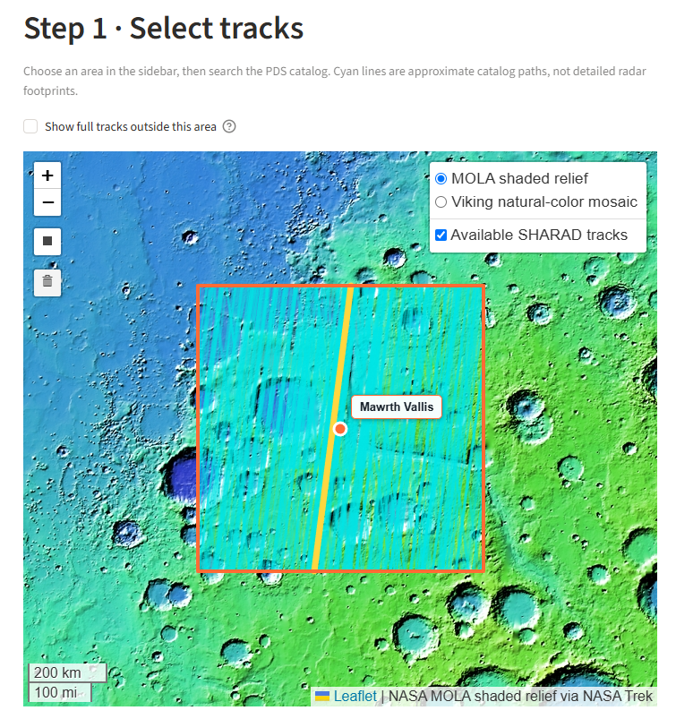
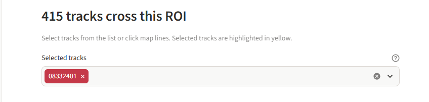
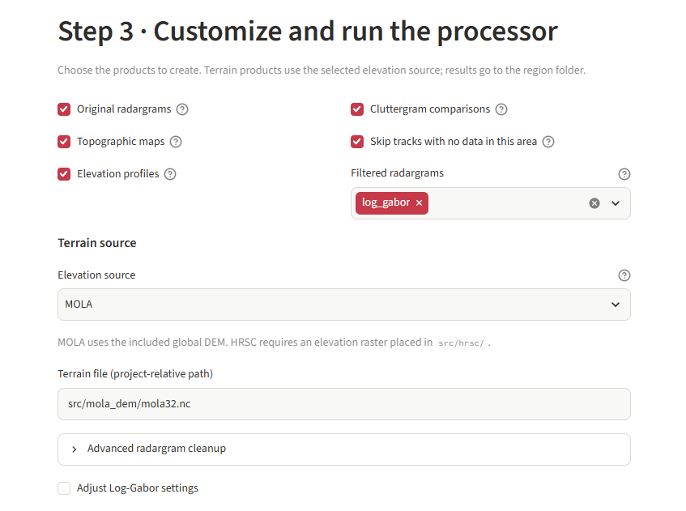
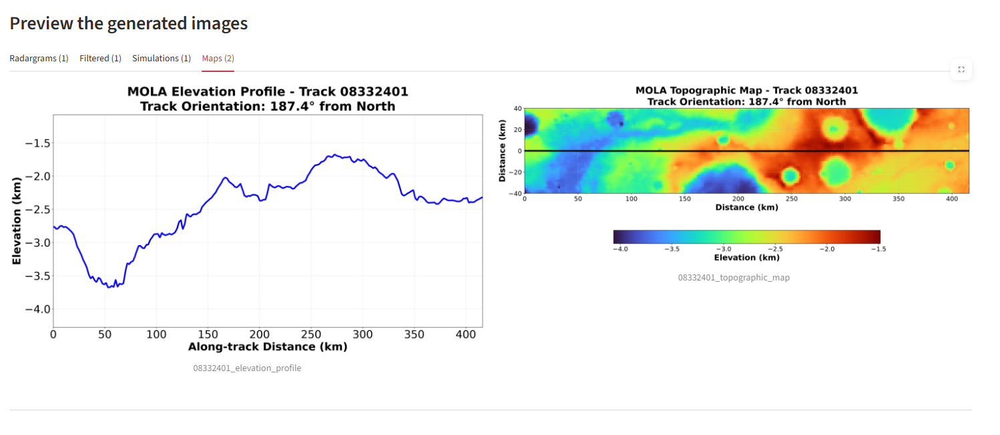
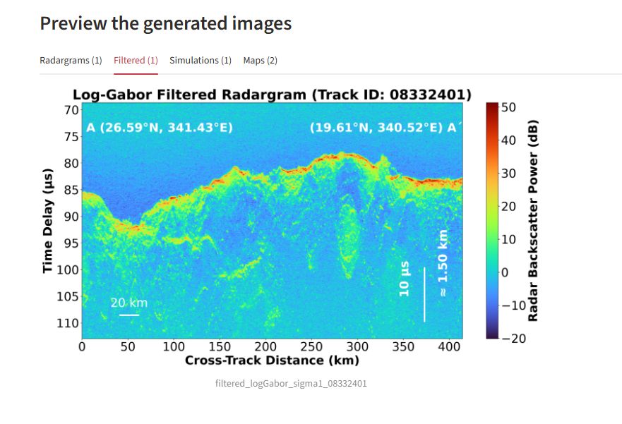

# Mars SHARAD Track Explorer

Explore Mars Reconnaissance Orbiter SHARAD observations by region, select
tracks, prepare a downloader-ready list, and process archive data into
filtered radargram, simulations and terrain products. This workspace brings together the public
[PDS SHARAD USRDR V2 radargram archive](https://pds-geosciences.wustl.edu/mro/mro-m-sharad-5-radargram-v2/)
and the [PDS SHARAD Clutter Simulations archive](https://pds-geosciences.wustl.edu/mro/mro_sharad_simulations/).
The clutter simulations are precomputed using MOLA topography and can be
compared with measured radar echoes. The included downloader and
`sharad_processor.py` carry selected observations through acquisition and
processing; separate HRSC or MOLA elevation rasters can supply terrain data
for maps and profiles.

## What the datasets do

| Dataset | Purpose in this project |
| --- | --- |
| **PDS radargram catalog** | Lists observation IDs, orbit and acquisition times, and approximate start/end coordinates. The Explorer searches these records to find candidate tracks crossing an ROI. |
| **USRDR V2 radargram** (`s_<track_id>_rgram.img` and `.lbl`) | Measured radar echoes and label metadata describing the product. The processor maps the measurements to the track geometry and creates radargram images. |
| **Track geometry** (`s_<track_id>_geom.tab` and `.lbl`) | Geographic positions associated with radar samples, with a product label. The processor uses the coordinates to locate the track, select the ROI portion, and position products. |
| **Radargram browse product** (`s_<track_id>_tiff.tif` and `.lbl`) | Archive TIFF browse image and its label, downloaded with the observation products. |
| **MOLA-based clutter simulation** (`_sim.img/.xml`, `_emap.img/.xml`, `_rtrn.csv/.xml`) | Precomputed surface-echo simulations based on MOLA topography, with elevation-map and return-table products and their metadata. The processor uses available simulation data for comparison with the measured radargram. A browse hillshade TIFF is also downloaded. |
| **HRSC or MOLA elevation** | Provides terrain heights for topographic maps and elevation profiles. This is a separate processor input. |
| 

The map uses approximate catalog endpoint paths to identify candidate crossings.
They are useful for searching and selecting observations; the geometry files
provide the more detailed location information used in processing.

## Why use this tool?

This app combines ROI-based track discovery, selection, downloading, and batch
processing in one focused workflow. Radargram filters, clutter-simulation comparisons, and
reference terrain products (footprint, elevation profile) can all be generated for the selected tracks.


## Start the Explorer

In PowerShell, move to the project folder, install its dependencies, and start
the app:

```powershell
Set-Location <project-folder>
python -m pip install -r requirements-track-explorer.txt
python -m streamlit run sharad_explorer_app.py
```

The page opens in your browser. Keep the terminal open while using the app.

## A short walkthrough

The figures below follow the workflow from finding and selecting tracks through
processing and reviewing the generated products.

### 1. Find tracks for an area

Choose a known Mars region in the sidebar, or set your own square region of
interest (ROI). Type latitude and east longitude directly in the sidebar to
recenter the map, click a point on the map and select **Use map point as ROI
center**, or use the map's rectangle tool to set the ROI center and width.
The center uses latitude and east longitude from 0 to 360 degrees; the width is
in degrees. A drawn rectangle is converted to a square using its larger
latitude/longitude span. Select **Find tracks crossing this ROI**.
Use the map's layer selector to switch between the default MOLA shaded relief
and the Viking natural-color mosaic.
Click cyan candidate lines on the map or select IDs in the **Selected tracks**
bar. Selected tracks appear in yellow. Each selected ID appears as a chip;
click its **×** to remove it without a separate button for every track.

The search uses the public
[NASA PDS SHARAD radargram index](https://pds-geosciences.wustl.edu/mro/mro-m-sharad-5-radargram-v2/mrosh_2101/index/index.tab).
The Explorer caches the catalog for one day. To load the latest index, open
**Catalog options** in the sidebar and select **Refresh catalog now**. The
selected ROI and its tracks are carried into the next steps.

<br><br>

<div align="center">
  
  <p><strong>Figure 1.</strong> Search an area and inspect candidate track crossings on the map.</p>
</div>

<br><br>

### 2. Review and download the selected data

The generated track list contains the ROI latitude, east longitude, and width
on its first line, followed by the selected track IDs. Expand **Preview or save
the track-list file** to inspect or save it. Select **Download N selected
tracks** to run the complementary SHARAD Downloader.

The app uses the project's fixed data folders:

| Folder | Contents |
| --- | --- |
| `src/sharad/radargrams/` | Radargrams, labels, geometry tables, and converted geometry products |
| `src/sharad/cluttergrams/` | Cluttergram simulation files and their labels |

The Explorer checks for files needed by the selected processing options and
shows the downloader console. The downloader remains a separate tool; its
download behavior and options are maintained there.

<br><br>

<div align="center">
  
  <p><strong>Figure 2.</strong> Review the selected track IDs before downloading their data.</p>
</div>

<br><br>

### 3. Configure and run processing

Choose which products to create. The **Area name** in the sidebar is used for
the map, saved track list, and output folder (`output/<area_name>/`). Terrain
settings appear only when **Topographic maps** or **Elevation profiles** are
selected.

<br><br>

<div align="center">
  
  <p><strong>Figure 3.</strong> Choose processing products and terrain settings before starting a run.</p>
</div>

<br><br>

| Option | Result |
| --- | --- |
| **Original radargrams** | Creates radargram images from the measured echoes. |
| **Filtered radargrams** | Creates filtered versions using Gaussian smoothing, Lee speckle reduction, Log-Gabor noise reduction, or a combination. Leave the selection empty to skip filtering. |
| **Mask persistent bright vertical channels** | On by default under **Advanced radargram cleanup**. Detects bright columns that exceed neighboring channels across most of the radargram, then shows the same channel span in black in original and filtered radargram images. Detection sensitivity and mask width can be adjusted there. |
| **Cluttergram comparisons** | Processes available precomputed MOLA-based simulation products. |
| **Topographic maps** | Uses the selected elevation file and track geometry to create terrain maps. |
| **Elevation profiles** | Plots terrain height along the selected tracks. |
| **Skip tracks with no data in this area** | Keeps processing focused on selected ROI crossings. |
| **Adjust Log-Gabor settings** | Sets filter parameters; defaults match the processing module. |

When terrain products are selected, enter an elevation file path relative to the
project folder. MOLA is selected by default and uses
`src/mola_dem/mola32.nc` when present. If only `src/mola_dem/mola32.zip` is
present, the app extracts `mola32.nc` from it the first time MOLA terrain data
is needed. HRSC requires a local raster, such as
`src/hrsc/mawrth_vallis_hrsc.tif`. The two sources use different terrain
workflows: HRSC uses the selected local HRSC raster with the processor's
track-aligned map interpolation; MOLA reads a local window from the global MOLA
NetCDF grid and interpolates elevations onto a track-aligned map grid. Both map
workflows rotate to follow the selected radar track and clip the along-track
extent to its endpoints. Elevation profiles sample the selected source directly
along the track.

Missing input files and terrain data are reported before the processor runs.
Select **Run SHARAD processor** to see live output. The app previews images
generated during the run.

Results are saved under `output/<area_name>/`:

| Folder | Products |
| --- | --- |
| `radargrams/` | Original radargram images |
| `filtered/` | Filtered radargram images |
| `simulations/` | Processed cluttergram images |
| `maps/` | Topographic maps and elevation profiles  |
| `logs/` | Processing logs and skipped-track information |

The app previews generated products after processing. The examples below show
the terrain map and elevation profile together, followed by a Log-Gabor filtered
radargram.

<br><br>

<div align="center">
  
  <p><strong>Figure 4.</strong> Review the generated terrain map and elevation profile in the app.</p>
</div>

<br><br>

<div align="center">
  
  <p><strong>Figure 5.</strong> Inspect a filtered radargram preview after processing.</p>
</div>

<br><br>

## Project layout

```text
sharad_processing/
├── sharad_explorer_app.py        # Guided SHARAD map, download, and processing app
├── track_discovery.py            # PDS catalog loading and ROI search
├── sharad_processor.py           # Processing functions and batch interface
├── run_processing.py             # Editable command-line example
├── requirements-track-explorer.txt
├── src/
│   ├── sharad/
│   │   ├── sharad_download.py    # Complementary downloader
│   │   ├── sharad_download.log   # Downloader activity log
│   │   ├── radargrams/           # Downloaded radargram and geometry inputs
│   │   └── cluttergrams/         # Downloaded cluttergram inputs
│   ├── hrsc/                     # HRSC elevation data
│   └── mola_dem/                 # MOLA elevation data
├── output/
│   ├── logs/                     # Shared and archived tool logs
│   └── <area_name>/              # Generated products by region
├── tests/                        # Workflow and data-discovery tests
└── docs/
    └── screenshots/              # App screenshots used in this guide
```


## Command-line processing

`run_processing.py` contains an example configuration for the command-line
workflow. Review and customize its variables for your region and inputs before
running it. The Explorer provides the same processing options in the interface.
For custom Python workflows, import `SHARADProcessor`,
`read_roi_from_track_file`, or `run_batch_processing` from
`sharad_processor.py`.

## Feedback and contributions

Comments, suggestions, bug reports, and contributions are welcome. Open an
issue to share feedback or propose an improvement, or submit a pull request
with a focused change.
